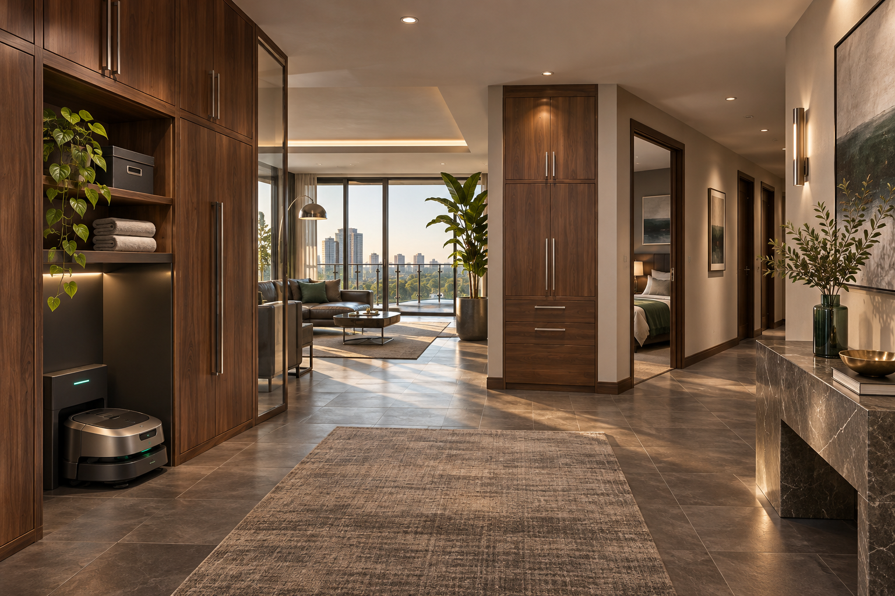
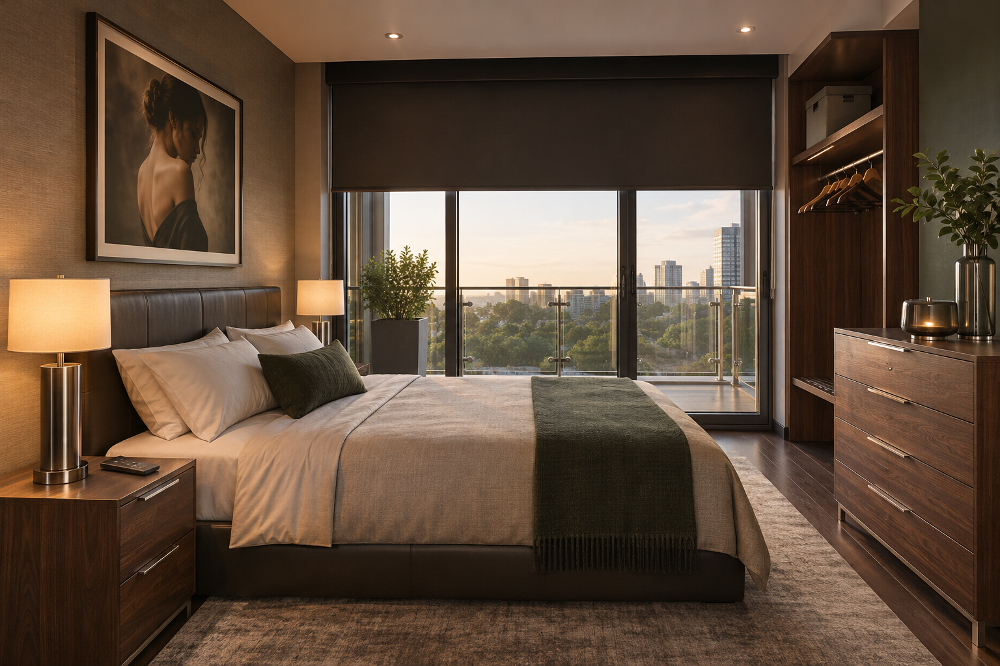

# Household room-art review

New generated review assets. Existing approved artwork is preserved. Not wired into the live game. Source images are 1536×1024 (3:2) for the existing 1100×733 display frame; these are architectural concepts, not exact floor plans. Written room graphs remain authoritative.

## Richard

### Suite 7A · Entry hall

### Living room and workspace

### Kitchen and bar

### Guest bedroom

### Guest bathroom

### Master bedroom

### Walk-in wardrobe

### Private master bathroom

### City-view balcony

## Nadia

- Entry hall: generation pending.

- Living room: generation pending.

- Kitchen & dining: generation pending.

- Bedroom: generation pending.

- Bathroom: generation pending.

- Walk-in closet: generation pending.

## Erin

- Living Room: generation pending.

- Kitchen & Dining: generation pending.

- Bedroom: generation pending.

- Bathroom: generation pending.

- Closet: generation pending.

- Entry Hall: generation pending.

## Priya

- Living Room: generation pending.

- Kitchen & Dining: generation pending.

- Bedroom: generation pending.

- Bathroom: generation pending.

- Walk-in Closet: generation pending.

- Entry Hall: generation pending.

