## Approval and integration

Owner approved the revised Erin/Priya sets and all four utility views. All31images are approved. All room and hallway-utility illustrations are connected in the published v1.0.109 game.

# Household room-art review

All 31 current illustrations are saved for owner review. Erin’s six and Priya’s six images replace rejected files in place. Accepted Richard/Nadia room images remain unchanged. Four utility-cupboard views show laundry and cleaning storage, including Richard’s bot charging stand. Floors: Priya 2F, Erin 3C, Nadia 6E, Richard 7A. Sources are approximately 3:2 for the 1100×733 display frame; per-file dimensions are in the manifest. Illustrations remain review concepts; written room graphs control gameplay.

## Richard

### Suite 7A · Entry hall

### Living room and workspace

### Kitchen and bar

### Guest bedroom

### Guest bathroom

### Master bedroom

### Walk-in wardrobe

### Private master bathroom

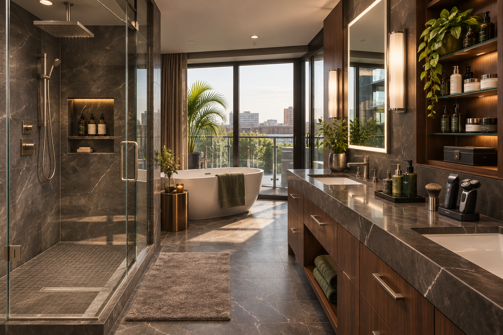

### City-view balcony

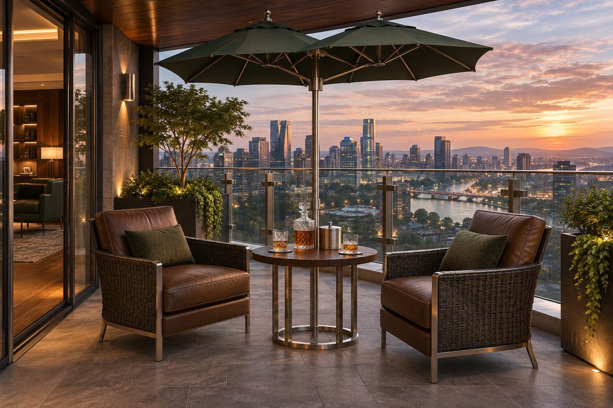

## Nadia

### Entry hall

### Living room

### Kitchen & dining

### Bedroom

### Bathroom

### Walk-in closet

## Erin

### Living Room

### Kitchen & Dining

### Bedroom

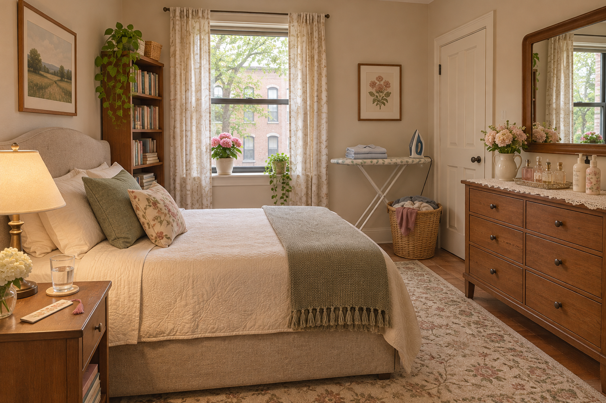

### Bathroom

### Closet

### Entry Hall

## Priya

### Living Room

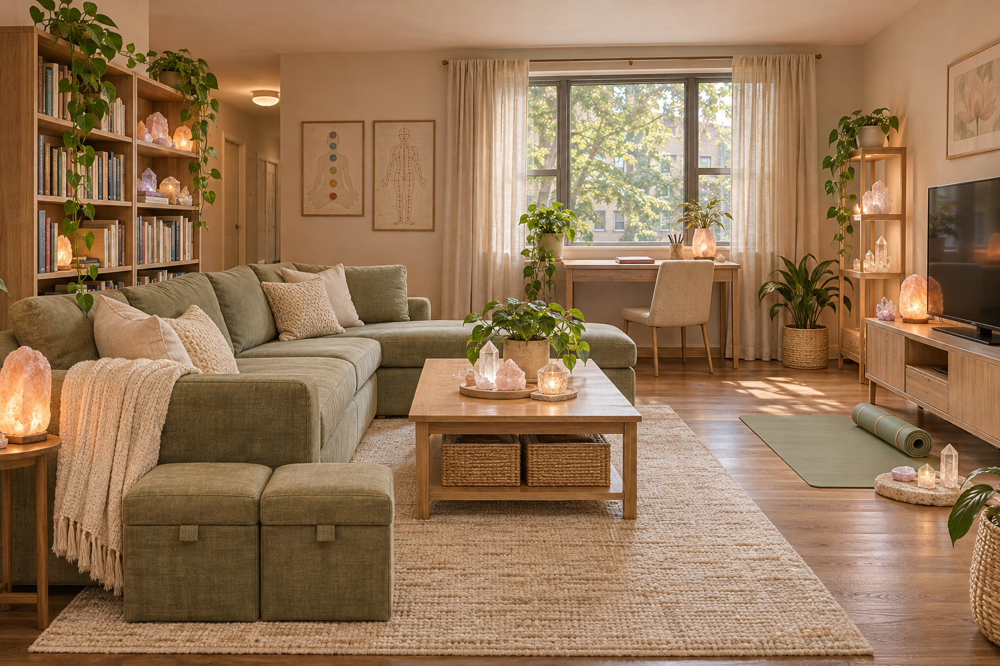

### Kitchen & Dining

### Bedroom

### Bathroom

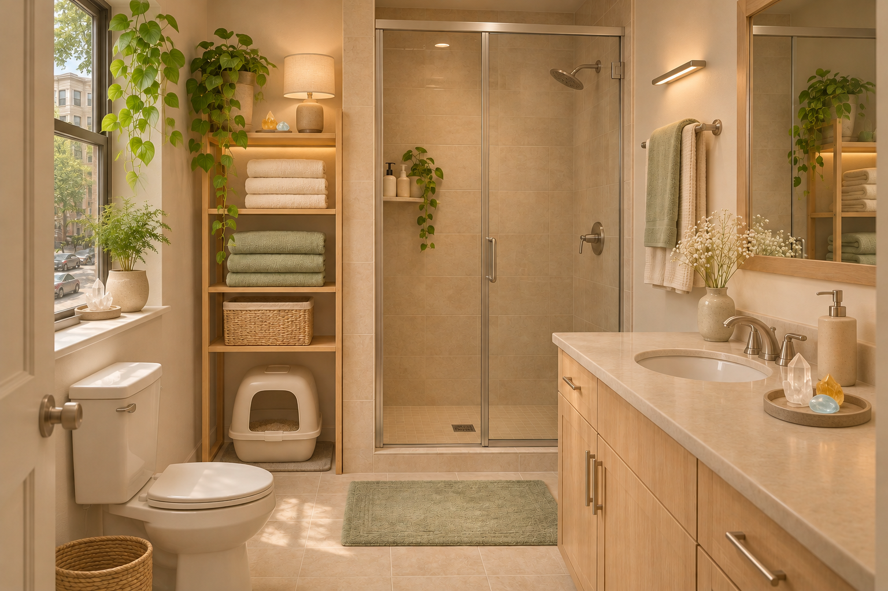

### Walk-in Closet

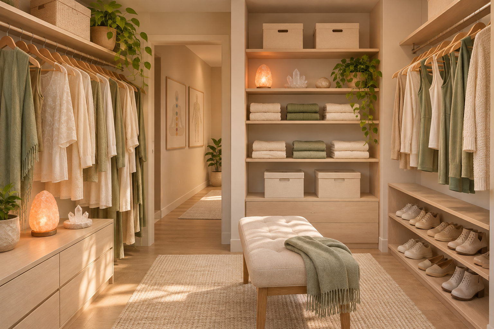

### Entry Hall

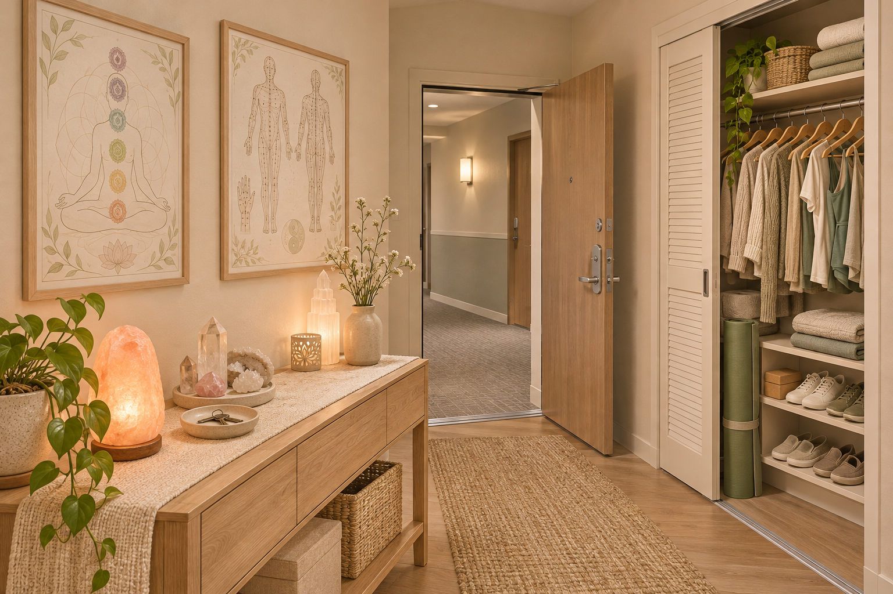

## Hallway utility cupboard views

### Richard

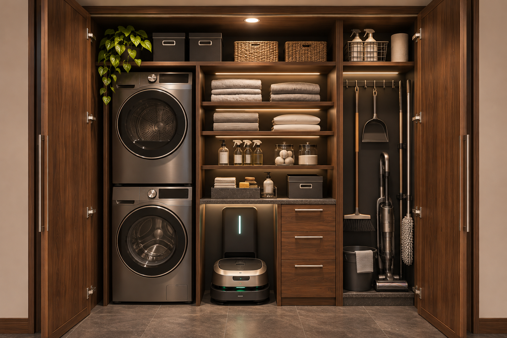

### Nadia

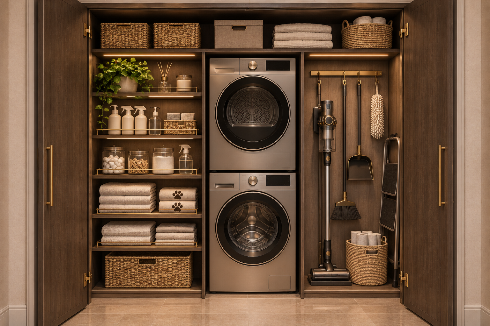

### Erin

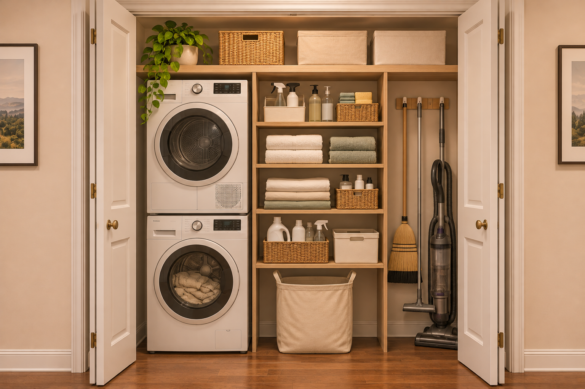

### Priya

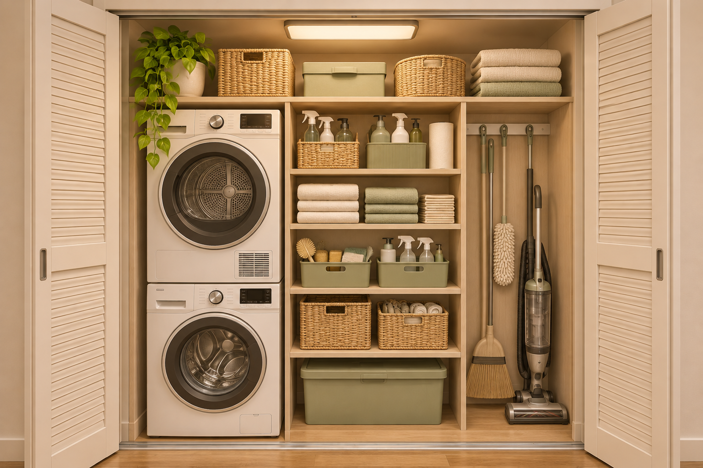

