# Household room-art review

All 27 room illustrations are generated and saved for owner review. They are not wired into the live game. Existing approved artwork is preserved. Source images are 1536×1024 (3:2) for the existing 1100×733 display frame; they have not been resized. Written room graphs control actual doors, ownership and travel; illustrations are architectural concepts, not exact floor plans. Inspect each before approval: generation may introduce visual details that are not authored gameplay.

## Richard

### Suite 7A · Entry hall

### Living room and workspace

### Kitchen and bar

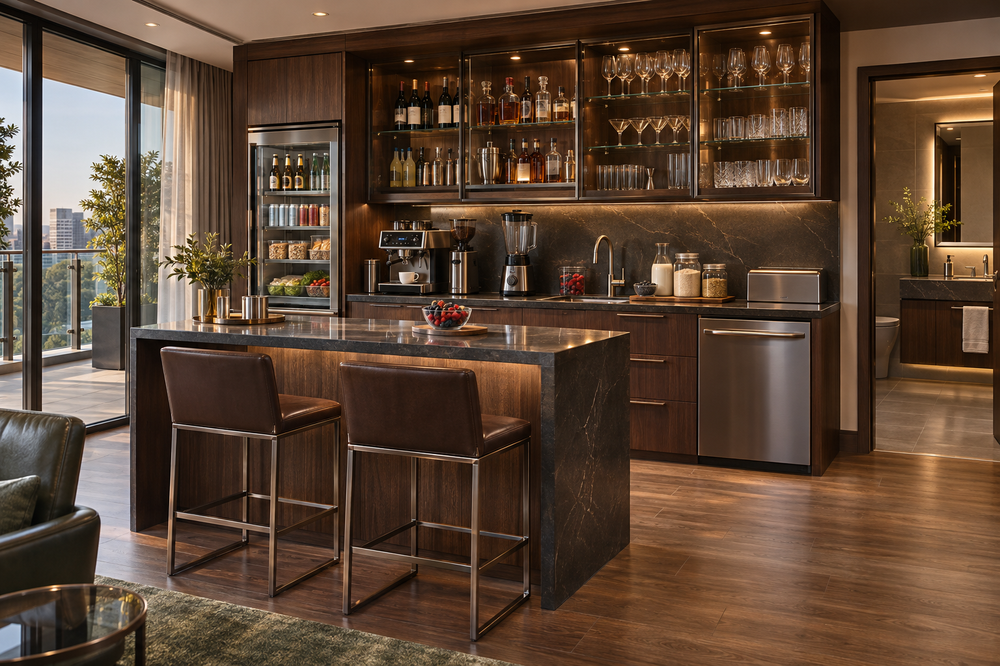

### Guest bedroom

### Guest bathroom

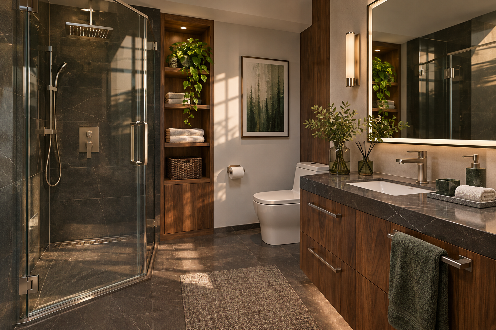

### Master bedroom

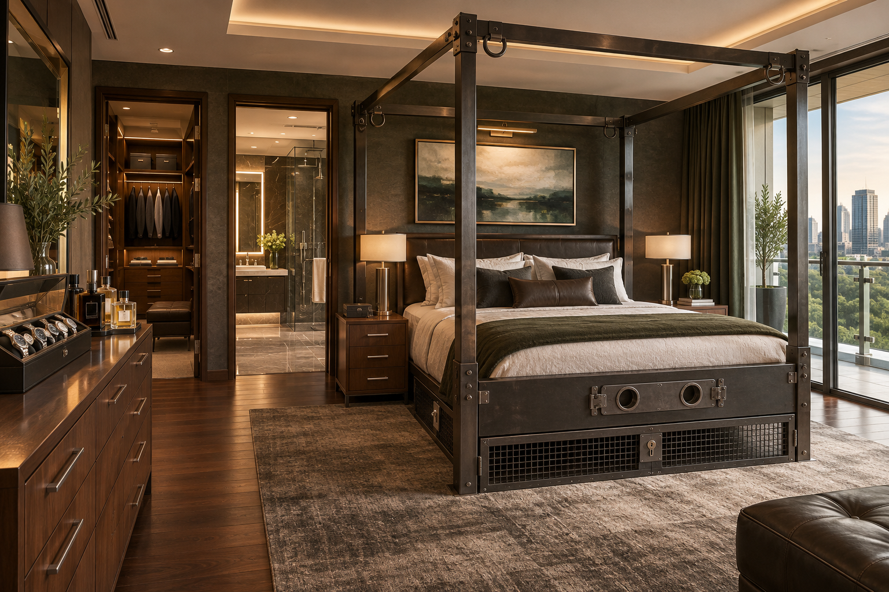

### Walk-in wardrobe

### Private master bathroom

### City-view balcony

## Nadia

### Entry hall

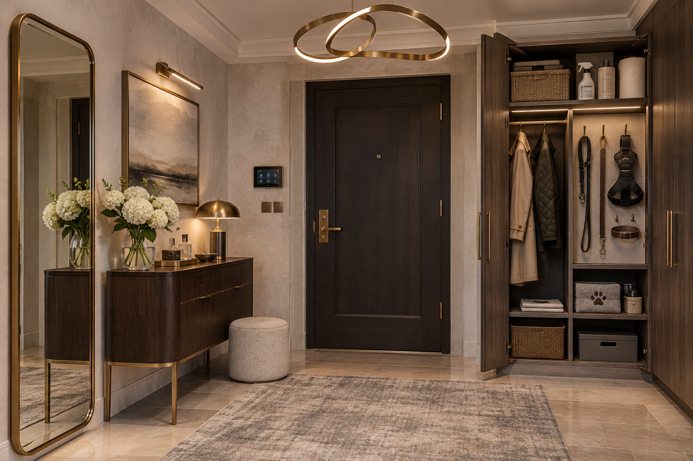

### Living room

### Kitchen & dining

### Bedroom

### Bathroom

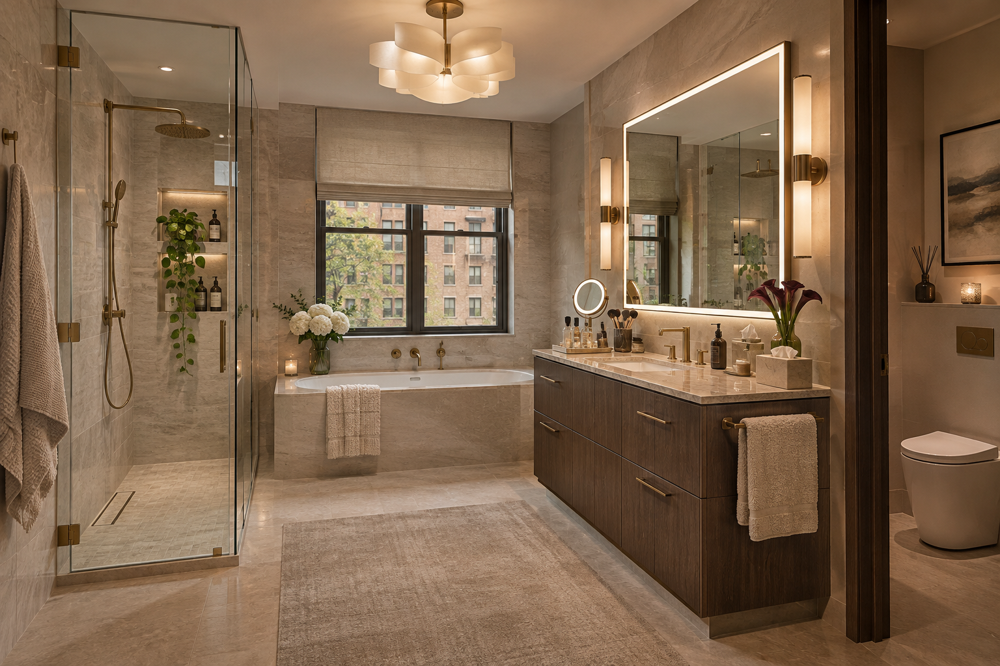

### Walk-in closet

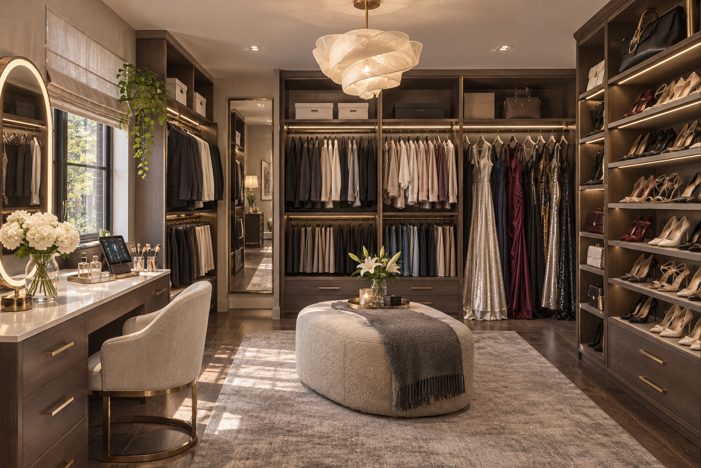

## Erin

### Living Room

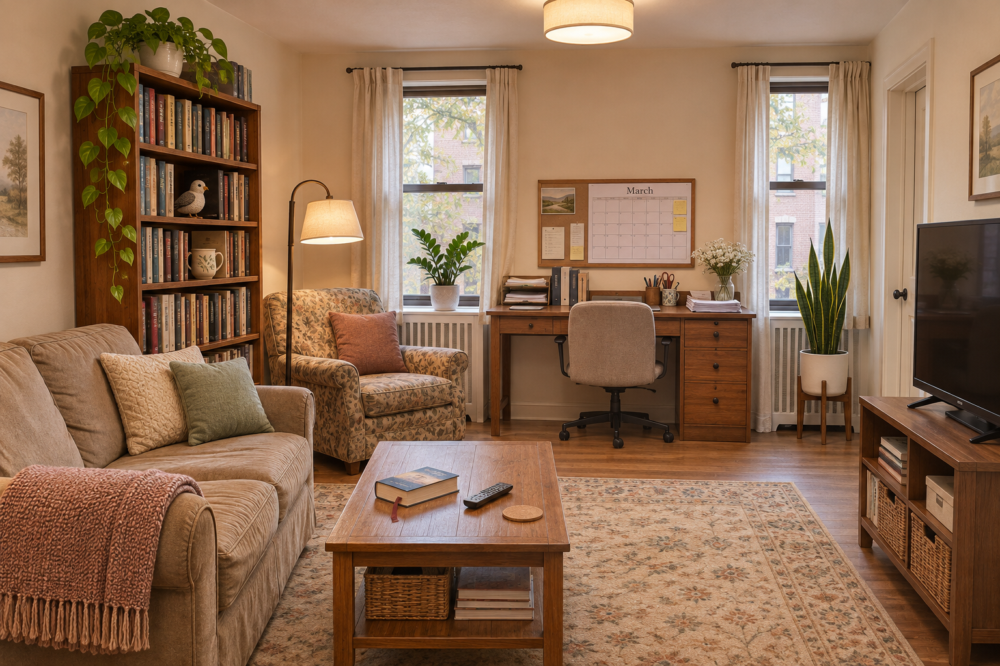

### Kitchen & Dining

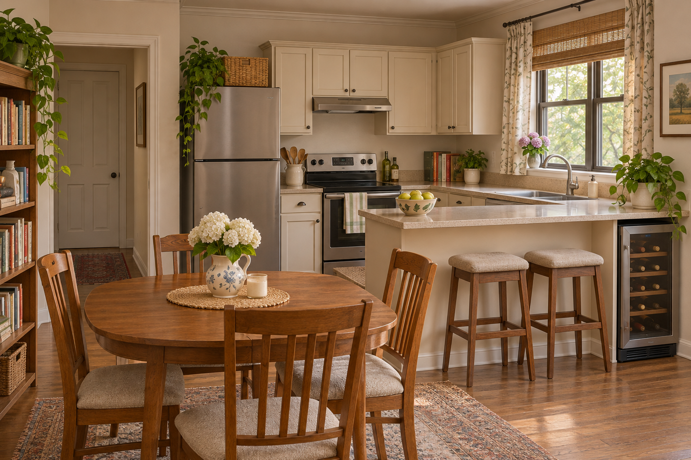

### Bedroom

### Bathroom

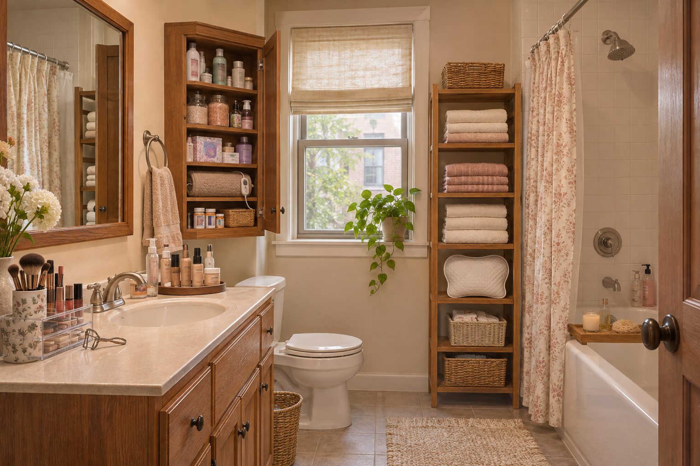

### Closet

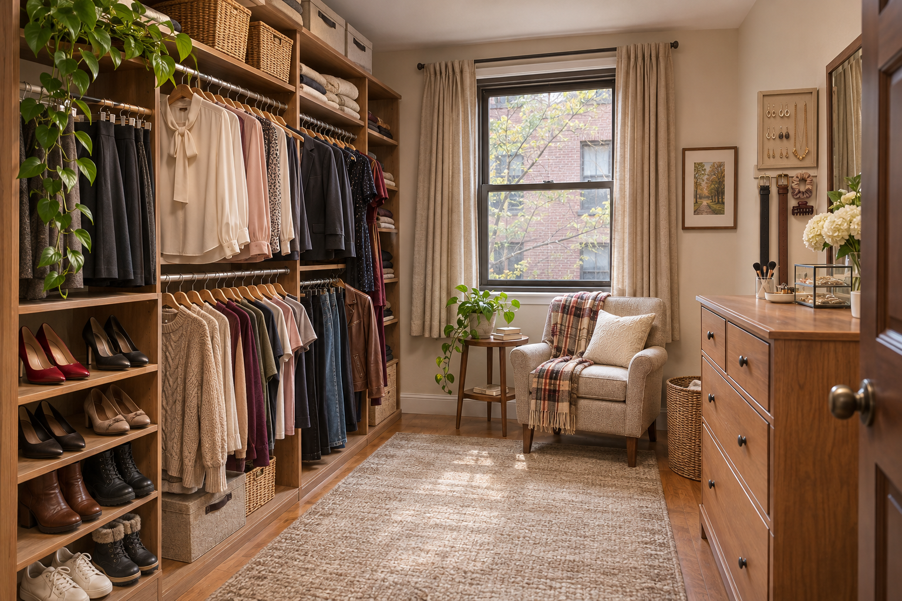

### Entry Hall

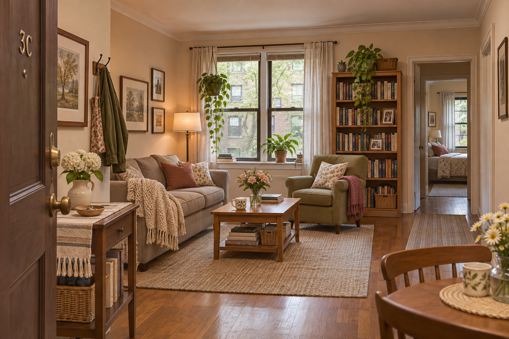

## Priya

### Living Room

### Kitchen & Dining

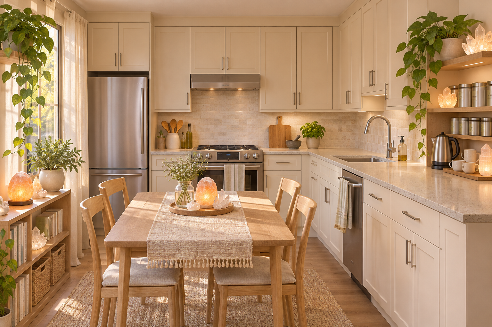

### Bedroom

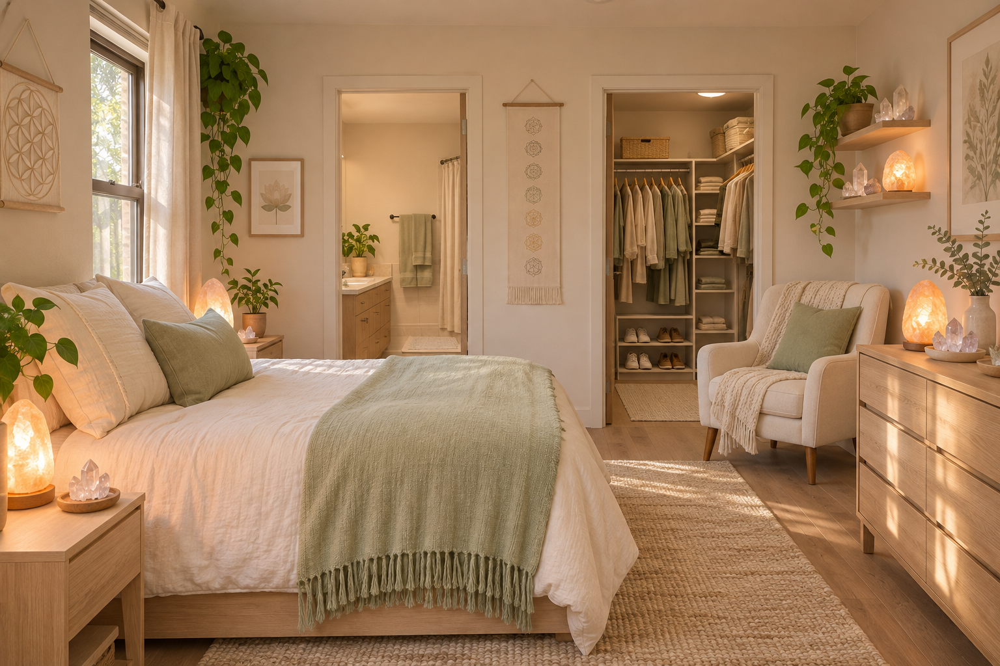

### Bathroom

### Walk-in Closet

### Entry Hall

